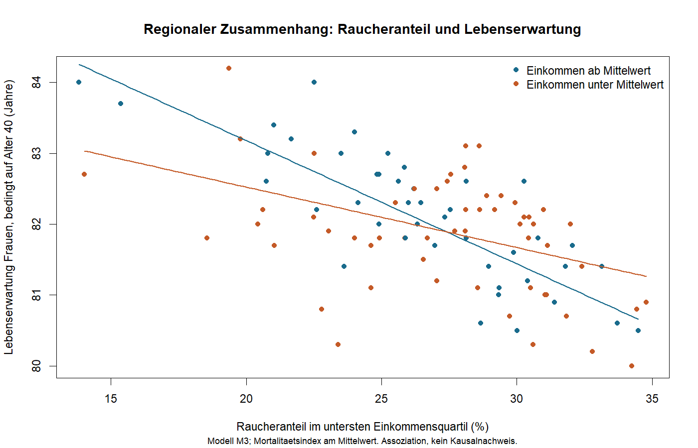

# Lebenserwartung, Rauchen und Einkommen in 100 US-Regionen (R)

*English: Multiple regression with an interaction term in R. In regions with a higher share of smokers, life expectancy is lower, and the slope differs between income groups (p = 0.005). Reproducible with base R.*

| | |
|---|---|
| **Rahmen** | BFH, Modul Datenmanagement und Datenanalyse (WDDA), Gruppenarbeit |
| **Team** | Bader, Jeckelmann, Marti, Fernando |
| **Mein Teil** | Der Analyseteil |
| **Methode** | Multiple lineare Regression mit Interaktion, Residuendiagnostik |
| **Werkzeug** | R (nur Base R), geprüft mit R 4.4.2 |

## Ergebnis auf einen Blick



- **Rauchen:** Ein um 10 Prozentpunkte höherer Raucheranteil geht mit einer um rund **1,25 Jahre** tieferen Lebenserwartung einher (Modell M1, bei gleichem Mortalitätsindex).
- **Einkommen allein** erklärt zusätzlich nichts (p = 0,73).
- **Interaktion:** In Regionen mit überdurchschnittlichem Einkommen ist der Zusammenhang etwa doppelt so steil: −1,7 statt −0,9 Jahre pro 10 Prozentpunkte (Modell M3, Interaktion p = 0,005). Das Modell erklärt damit **46 %** der Streuung zwischen den Regionen (R² = 0,46).

| Modell | Variablen | R² | Adj. R² |
|---|---|---:|---:|
| M1 | Raucheranteil + Mortalitätsindex | 0,416 | 0,403 |
| M2 | M1 + Einkommen unter dem Mittelwert | 0,416 | 0,398 |
| M3 | M2 + Raucheranteil × Einkommensgruppe | **0,464** | **0,441** |

Es sind regionale Beobachtungsdaten: Die Analyse zeigt Zusammenhänge zwischen Regionen, keine ursächlichen und keine individuellen Effekte.

## Fragestellung

Wie hängen die Lebenserwartung von Frauen im untersten Einkommensquartil (bedingt auf das Erreichen von 40 Jahren), der regionale Raucheranteil, ein 30-Tage-Mortalitätsindex und das Haushaltseinkommen zusammen? Untersucht werden 100 US-Commuting-Zones aus dem Health Inequality Project.

## Ausführen

```sh
Rscript scripts/analyse.R
```

Oder in RStudio das Arbeitsverzeichnis auf diesen Ordner setzen und `source('scripts/analyse.R')` ausführen. Die Ergebnisse (Modellzusammenfassungen, Modellgüte, Grafik, Diagnoseplots) landen in `results/`.

## Aufbau

| Ordner | Inhalt |
|---|---|
| `scripts/analyse.R` | Portfolio-Fassung: Eingabeprüfungen, drei Modelle, automatischer Export |
| `data/` | gelieferte Excel-Dateien und daraus erzeugte CSV-Eingaben |
| `results/` | `model-summary.txt`, `model-fit.csv`, `interaction.png`, `diagnostics.pdf` |
| `original/` | unveränderte Abgabe mit SHA-256-Prüfsummen |

## Gegenüber der Abgabe verbessert

- CSV und relative Pfade statt Excel-Abhängigkeiten und interaktiver `View()`-Aufrufe.
- Interaktionslinien direkt aus M3 (bei mittlerem Mortalitätsindex) statt zweier getrennter einfacher Regressionen.
- Raucheranteil in der Grafik korrekt in Prozent.
- Kausale Formulierungen durch Aussagen über Zusammenhänge ersetzt.
- Der Raucherkoeffizient von M1 ergibt mit den gelieferten Daten −12,49 (die Abgabe nannte im Kommentar etwa −12,28); gültig sind die neu berechneten Werte.

## Daten und Grenzen

Datenquelle: Health Inequality Project (`CZ Rankings - Levels`, `Online Data Table 10`), bereits in der Abgabe in Excel aufbereitet. Für die CSV-Dateien wurden nur leere Spalten und Zeilen ohne Regions-ID entfernt; verbunden wird über `Commuting Zone ID`. Die Einkommensschwelle ist der Mittelwert der 100 Regionen.

Grenzen: Beobachtungsdaten, mögliche fehlende Einflussfaktoren, räumliche Abhängigkeit, Informationsverlust durch die Zweiteilung des Einkommens; die Modellgüte gilt nur innerhalb der Stichprobe. Die Weiterverwendungsbedingungen der Quelldaten sind nicht separat geprüft; für Daten und Gruppenbeiträge gilt keine Open-Source-Lizenz.

---

Weitere Projekte: [Portfolio von Jonas Bader](https://jonasbader7.github.io/Portfoliopage/)
